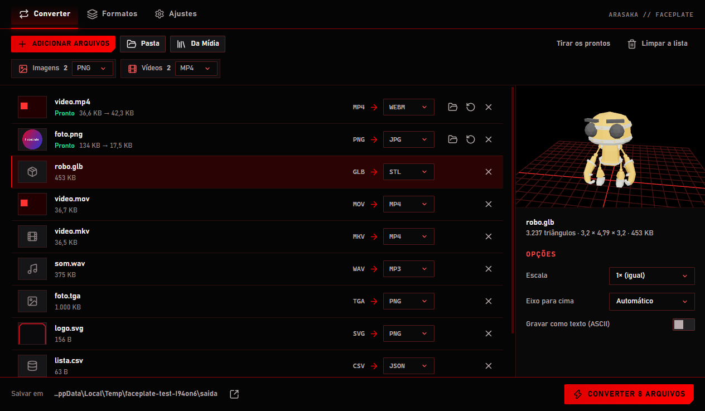

# Arasaka Faceplate

Conversor de arquivos da [Arasaka Central](https://github.com/Ruiso-Outside/ArasakaCentral). Roda dentro da Central, sem `.exe` e sem enviar nada para a internet.



| Tipo | Abre | Converte para |
|---|---|---|
| Imagens | png, jpg, webp, gif, bmp, avif, svg, ico, heic, tiff, tga | png, jpg, webp, gif, bmp, tiff, tga, ico, pdf (GIF animado também vira mp4 e webm) |
| Vídeos | mp4, m4v, mov, webm, mkv, ts, mts, m2ts | mp4, webm, mov, mkv, gif, mp3, m4a, wav, ogg, flac, jpg, png |
| Áudios | mp3, wav, ogg, opus, flac, m4a, aac, weba | mp3, m4a, wav, ogg, flac |
| Objetos 3D | glb, gltf, obj, fbx, stl, ply, dae, 3ds, 3mf, amf, wrl, usdz | glb, gltf, obj, stl, ply, 3mf, usdz, png |
| PDF | pdf | png, jpg, webp, txt |
| Dados e textos | json, csv, tsv, yaml, xml, md | json, csv, tsv, yaml, xml, html |
| Legendas | srt, vtt, ass, ssa | srt, vtt, ass, txt |
| Fontes | ttf, otf, woff | ttf, otf, woff |

Ainda não abre: avi, wmv, flv, fontes WOFF2 e modelos com compressão Draco ou texturas KTX2.

## Estrutura

| Caminho | Conteúdo |
|---|---|
| `module/module.json` | Manifesto e ferramentas da IA (`list_formats`, `convert_files`) |
| `module/backend.js` | Motor: servidor de arquivos local, gravação em pedaços, Mídia, IA |
| `module/web/js/formats.js` | Tabela de formatos (usada pela tela e pelo motor) |
| `module/web/js/image.js`, `av.js`, `model.js`, `docs.js` | Conversores |
| `module/web/js/app.js` | Tela: lista, opções, prévia e fila |
| `module/web/vendor/` | Bibliotecas prontas e licenças (`LICENSES.txt`) |
| `i18n/` | Textos e dicionários (inglês e espanhol) |
| `catalog-entry.json` | Entrada para a lista `modules` do `catalog.json` da Central |

## Desenvolvimento

```
npm run module     # dist/piphin-module-conversor-X.Y.Z.zip (só Node, sem instalar nada)
npm install        # só para os comandos abaixo
npm run vendor     # monta de novo module/web/vendor
npm run icon       # desenha o ícone
npx electron --disable-gpu-sandbox test/run.js <clone da ArasakaCentral>
```

O teste roda o módulo no `ModuleHost` de verdade, com pastas temporárias, e converte cada formato para todos os destinos. `FP_EXTRA=<pasta>` acrescenta arquivos seus.

## Publicar

1. Envie a tag: `git tag v1.0.0` e `git push origin v1.0.0`. O GitHub monta o `.zip` e publica o Release (`.github/workflows/release.yml`). A tag precisa bater com a versão do `package.json`.
2. Na primeira vez, acrescente o conteúdo de `catalog-entry.json` à lista `"modules"` do `catalog.json` da Central.

As versões seguintes saem pela aba Desenvolvedor da Central, que envia a tag.
